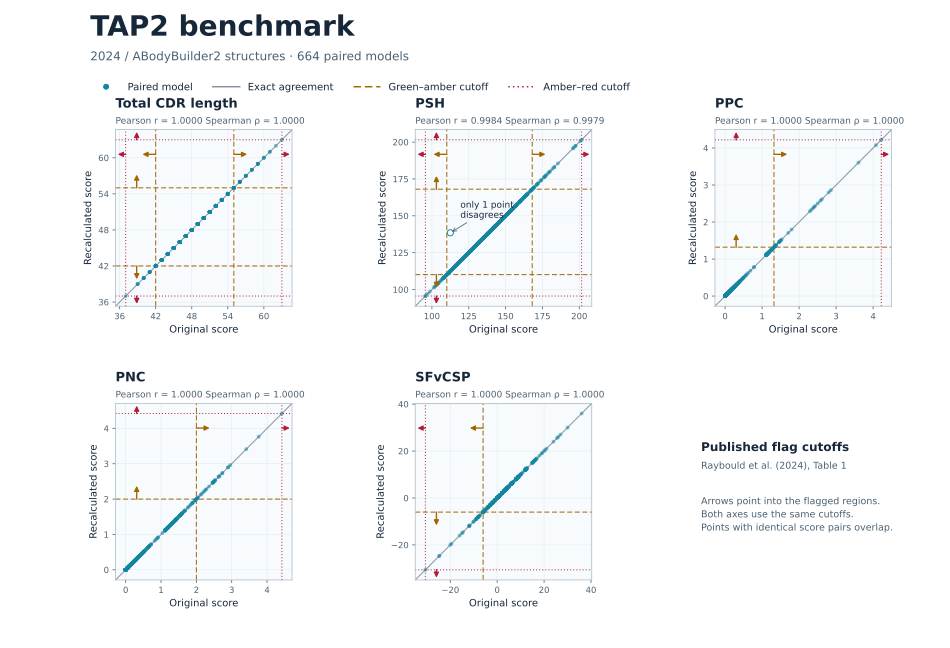
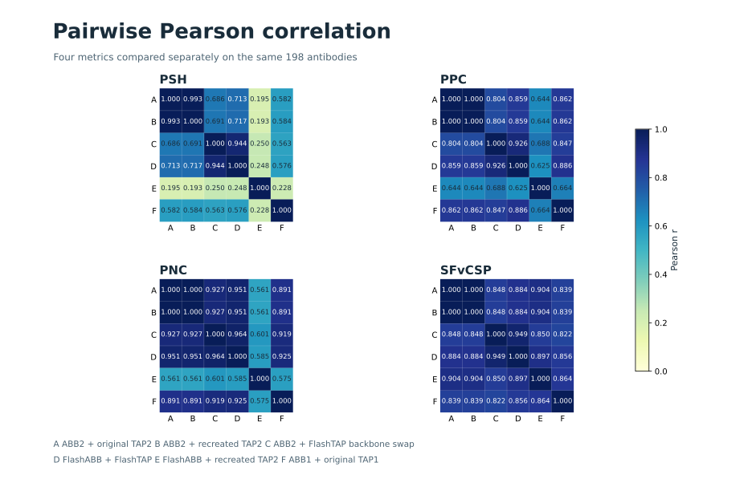
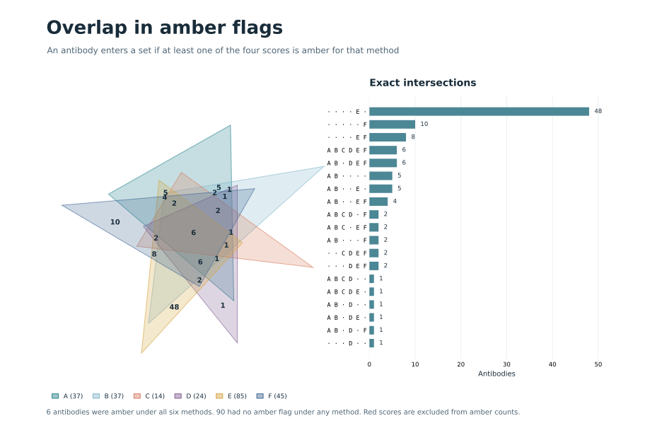

# Therapeutic Antibody Profiler2

```text
\\       //                                  \\       //
 \\     //       _____  _    ____ ____        \\     //
  \\   //       |_   _|/ \  |  _ \___ \        \\   //
   \\_//          | | / _ \ | |_) |__) |        \\_//
     ||           | |/ ___ \|  __// __/           ||
     ||           |_/_/   \_\_|  |_____|          ||
     ||                                           ||
```

TAP2recreated is an independent reconstruction of the Therapeutic Antibody Profiler 2 (TAP2) scoring algorithm. It combines the published TAP methods with the side-chain accessibility implementation from Oxford's [Therapeutic Nanobody Profiler (TNP)](https://github.com/oxpig/TNP). The implementation may differ from the exact code used to generate the published TAP2 results.

The maintainer is not affiliated with the Oxford Protein Informatics Group (OPIG/oxpig) or with the authors of the original code and papers.

The scorer takes a full-atom, IMGT-numbered antibody Fv PDB and calculates total CDR length, patches of surface hydrophobicity (PSH), patches of positive charge (PPC), patches of negative charge (PNC), and the structural Fv charge symmetry parameter (SFvCSP).

## TAP2 benchmark



Rituximab Run 1 disagreed on PSH, while Runs 2 and 3 agreed. The discrepancy did not change its flag status, and its cause is unclear. All five scores agreed within 0.0001 for the other 663 models, supporting this as a faithful recreation.

Two conventions were inferred from the released benchmark. The scores reproduced using a **4.0 Å** CDR vicinity, although the TAP2 paper describes **4.5 Å**. Exposed salt-bridge partners take glycine's Kyte–Doolittle hydropathy for PSH and retain their residue charges for the charge metrics.

## Comparison with FlashTAP

We compared three generations of structure prediction (ABodyBuilder1, ABodyBuilder2, and FlashABB) and three generations of TAP scoring (TAP1, TAP2, and FlashTAP). The six configurations below use the same 198 antibodies, matched by exact heavy- and light-chain sequences across the 2019 and 2024 cohorts.

**TL;DR**
We consider **ABodyBuilder2 + TAP2** the most reliable method for detecting antibody developability flags. Using either FlashTAP and/or FlashABB gave noticeably worse results.

| ID | Structure predictor | Scoring method | Score source | Any amber | Any red |
|---|---|---|---|---:|---:|
| A | ABodyBuilder2 | Original TAP2 | Published 2024 scores | 37 | 0 |
| B | ABodyBuilder2 | Recreated TAP2 | [This repository](tap_score.py) | 37 | 0 |
| C | ABodyBuilder2 | FlashTAP, backbone swap | Pretrained FlashTAP head supplied with the archived ABodyBuilder2 backbone | 14 | 0 |
| D | FlashABB | FlashTAP | Default FlashTAP pipeline | 24 | 0 |
| E | FlashABB | Recreated TAP2 | This repository's scorer on FlashABB PDBs renumbered to IMGT | 85 | 66 |
| F | ABodyBuilder1 | Original TAP1 | Published 2019 scores | 45 | 0 |

FlashTAP ran in float32 with `flash-abb` 0.0.5. Correlations and flags cover the four structure-based metrics shared by all six configurations. Methods A–E use the 2024 ABodyBuilder2 TAP2 thresholds, and F uses the 2019 TAP1 thresholds. An antibody is counted as amber if any of the four scores is amber. A red score contributes only to the red count.





FlashTAP is the latest TAP algorithm and is a departure from the last two. It is a learned regression head on structure-aware embeddings as opposed to the structure-based TAP1 and TAP2 scores, particularly for PSH. Against original TAP2, PSH Pearson *r* was 0.686 with the ABodyBuilder2 backbone and 0.713 with FlashABB. While these scores deviate more than I was hoping for FlashTAP's differentiable scoring head may make it useful for developability optimization and so it is still a useful tool. [FlashABB and FlashTAP preprint](https://doi.org/10.64898/2026.06.03.729879)

**FlashABB + recreated TAP2** showed the weakest overall agreement with published TAP2. Every FlashABB structure in the matched set had at least one atom-atom clash compared to none in AbodyBuilder2 structures. These clashes artificially inflate PSH and are likely due to the lack of triangle attention or molecular-dynamics refinement. 

To investigate the effect of these clashes we tried altering the PSH algorithm to have a minimum atom-atom distance of **1.2 Å** which increased PSH Pearson *r* from **0.195 to 0.689**, roughly **3.5-fold** relative to TAP2 results. We kept the published inverse-square form without this experimental floor to stay close to the documented scoring method. We could not verify whether the original TAP2 implementation applied a lower distance bound.

## Usage

```sh
python -m pip install -r requirements.txt
python tap_score.py path/to/imgt_numbered_fv.pdb
```

Use a PDB with exactly two variable-domain chains, complete side chains, and IMGT numbering with insertion codes. The scorer writes one row of raw scores per PDB to standard output. The chain IDs default to `H` and `L`. Set `--heavy A --light B` for models with those chain IDs.

For FlashABB models, assign IMGT numbers before scoring because FlashABB's PDB export uses sequential residue numbering. The published flag cutoffs were derived from ABodyBuilder2 structures. Agreement with those flag calls has been benchmarked on the archived ABodyBuilder2 structures.

## Reproduce the benchmark

Download the [2024 Supplementary Data 1 workbook](https://static-content.springer.com/esm/art%3A10.1038%2Fs42003-023-05744-8/MediaObjects/42003_2023_5744_MOESM4_ESM.xlsx) and extract the Run 1 models from the [Oxford structure archive](https://doi.org/10.5281/zenodo.10357509).

```sh
python benchmark.py 42003_2023_5744_MOESM4_ESM.xlsx \\
  ABB2_AllCSTModels/CST_Models_ABB2_Run1 --workers 4
```

The script writes per-model score comparisons and flag calls to `tap2_2024_benchmark.csv`.

## References and attribution

1. **TAP1.** Raybould, M. I. J. et al. *Five computational developability guidelines for therapeutic antibody profiling.* PNAS (2019). [doi:10.1073/pnas.1810576116](https://doi.org/10.1073/pnas.1810576116)
2. **TAP2.** Raybould, M. I. J. et al. *Contextualising the developability risk of antibodies with lambda light chains using enhanced therapeutic antibody profiling.* Communications Biology (2024). [doi:10.1038/s42003-023-05744-8](https://doi.org/10.1038/s42003-023-05744-8)
3. **TNP.** Gordon, G. L., Gervasio, J., Souders, C. & Deane, C. M. *Characterising nanobody developability to improve therapeutic design using the Therapeutic Nanobody Profiler.* Communications Biology (2026). [doi:10.1038/s42003-026-09594-y](https://doi.org/10.1038/s42003-026-09594-y)

[`tap_surface.py`](tap_surface.py) comes from the [Oxford TNP source](https://github.com/oxpig/TNP/blob/ea619d119b9e9da00b0d40961769d7166ce7677f/src/theraprofnano/Hydrophobicity_and_Charge_Profiler/surface.py). The original BSD 3-Clause licence and attribution are in [LICENCE](LICENCE).
